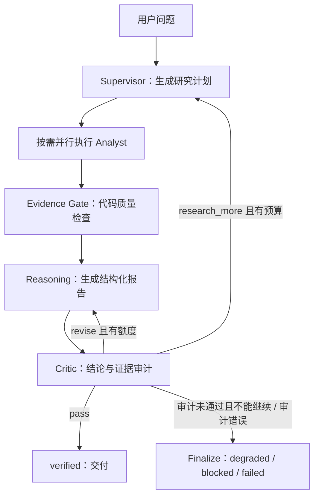

# Mosaic：Agent 应用研发面试讲述稿

整理日期：2026-10-13。依据当前工作区代码与验收文档；工作区包含未提交改动，不能将本文所有能力都归属于已发布版本。目标岗位：Agent 应用研发 / 大模型应用工程师。本人确认负责基础架构、MCP 编写和工具添加；具体故障修复与优化归属仍按实际经历表述。

## 0. 根据你的职责确定讲述重点

推荐主线：**我负责 Agent 基础架构和 MCP/工具接入，重点解决多数据源的调用契约、执行可靠性和结果标准化，让后续推理与审计有可追溯的数据基础。**

讲述时间建议：业务问题约 30 秒，整体架构约 1 分钟，个人负责的 MCP 与工具层约 2 分钟，一个真实技术问题约 1 分钟，结果和改进约 30 秒。

| 你的职责 | 面试要讲清楚的内容 | 能体现的能力 |
| --- | --- | --- |
| 基础架构 | 为什么分开编排、工具执行、数据归一化与交付；节点怎样通过结构化状态协作 | 模块边界、状态管理、可扩展性 |
| MCP 编写 | 连接与握手、工具发现、schema、工具调用、异常分类和资源释放 | 协议接入、异步编程、故障定位 |
| Tool 添加 | 工具何时应被选择、参数如何验证、结果如何标准化、失败如何暴露 | Tool design、数据契约、可测试性 |

现有仓库可以直接核对的是 **MCP 客户端与接入层**：`ClientSession`、stdio、`initialize()`、`list_tools()` 和 `call_tool()`。外部 Market Gateway server 不在本仓库。若你也编写了外部 server，面试时再结合那部分代码介绍服务端工具定义和实现；不要仅凭这个仓库把客户端适配说成完整协议或网关服务端实现。

### 你负责部分的推荐讲稿

> 我在项目里主要负责基础架构、MCP 编写和工具添加。架构上把研究编排、工具执行和数据处理分开，使新增数据源时能沿着明确的接口接入。
>
> MCP 这部分可以从调用链讲：先建立 stdio 连接，再初始化会话、发现工具和输入 schema，最后发起工具调用并解析结果。工程上还需要处理连接失败、工具错误、超时和资源清理。
>
> 工具接入除了写请求函数，还需要给规划器提供用途、市场域、参数和标的要求，把不同来源的返回转换为统一 ToolResult 和 NormalizedDatum，保留来源、数据日期、完整性及错误信息。这样后面的推理和审计才能判断这份数据能支持什么结论。
>
> 一个有代表性的接口问题是内部参数与 MCP schema 不一致：内部用标的数组便于去重和缓存，而上游可能要求逗号分隔字符串。这个转换应该放在传输边界，并依据发现的 schema 处理，避免业务节点都耦合上游格式。对于这部分，我会结合自己实际实现的代码和测试展开。

### 新增一个 Tool，怎样讲出完整工程过程

以“接入一个新的行情查询工具”为例，按以下顺序说明自己的真实实现：

1. **定义能力边界。** 查询证券还是指数；是否支持历史日期；数据是实时、收盘还是延迟；分页和权限有哪些限制。
2. **声明元数据。** 注册逻辑 key、实际操作名、用途、市场域、分析类别、优先级及是否必须传入标的，让规划与执行使用同一份信息。
3. **规范输入。** 明确 symbol 格式、日期和分页参数，进行本地校验；内部维持 canonical 参数，协议边界负责上游编码。
4. **实现执行适配。** 明确使用 MCP、HTTP 或内部函数；处理认证、超时、重试、缓存和错误分类。不同错误不能都变成“空结果成功”。
5. **规范输出。** 转换为 ToolResult / NormalizedDatum，保留数值、单位、标的、来源、数据日期、抓取时间和 partial。获取时间不能冒充行情日期。
6. **接入证据流程。** 验证正常数据能构建 Evidence，失败不会产生成功证据，部分数据不会被解释成完整市场覆盖。
7. **分层验证。** 测参数与解析、fake MCP session 的传输契约，以及真实端点的采集和终态。工具级成功与研究级通过分别记录。

### MCP 方向的重点追问

**MCP 和模型的 Tool Calling 怎么配合？** 本项目的 LLM 生成研究计划，代码读取计划并通过 MCP 客户端调用外部工具。MCP 承担客户端与工具服务之间的发现和调用协议，模型选择工具的能力来自规划机制。不能说“接入 MCP 就自动拥有规划和推理能力”。

**为什么保留 HTTP 通道？** 编排与数据处理复用相同内部契约，传输层可以按环境选择 MCP 或 HTTP。MCP 有会话、发现和子进程生命周期管理需求；HTTP 适合不具备本地 CLI 的部署环境。两条通道都需要独立验证传输契约。

**为什么需要逻辑 tool key 和实际 operation ID？** 多个业务能力可能复用一个上游操作。规划与缺口判定需要知道当前查询的业务意图，不能只凭 operation ID 就认为所有兄弟能力都已满足。

**会话怎样复用并避免并发请求串数据？** 当前 ToolRuntime 在一次 analyst 节点运行内按需建连并复用，通过 ContextVar 隔离会话；同会话首次建连受锁保护。MCP 的 AnyIO 资源要求在同一 task 中进入和退出，因此实现了 owner task 管理生命周期。这里的复用粒度是一次 analyst 运行，不能说所有请求共用一个全局会话。若这不是本人负责的改动，应作为理解整体实现来回答。

**怎样降低工具误选？** 工具描述交代清晰用途和限制，按市场域过滤候选，输出结构化计划，执行前校验参数，并将缺口明确到 tool key 和覆盖要求。工具数量增加后，还应评估描述歧义和近似能力误选，不能只看注册数量。

## 1. 项目定位与开场稿

一句话：**Mosaic 是一个以证据为中心的市场研究 Agent，把自然语言问题转化为研究计划，通过多源工具采集数据、生成结构化结论，并审计结论是否得到证据支持。**

约两分钟的口述版本：

> 我介绍的项目叫 Mosaic，是一个市场情报 Agent。我主要负责基础架构、MCP 编写和工具添加。用户可以问“今天 A 股发生了什么”或者“某只股票有哪些值得关注的变化”。项目希望把分散的行情、资金、财务和新闻数据组织成有来源、日期和证据引用的研究报告。
>
> 它基于 LangGraph 编排。Supervisor 用大模型理解问题、选择工具并生成结构化计划，再按技术面、基本面和资金面分配给执行节点并行采集。我的讲述重点是底层工具接入：怎样让不同数据源沿着一致的接口被调用，怎样验证参数并标准化返回结果。数据进入统一证据账本后，Reasoning 生成报告，Critic 检查结论和证据是否匹配。
>
> 项目里比较有代表性的设计是两种反馈路径：如果已有证据足够，只是结论措辞过强，就回到 Reasoning 修改；如果缺少数据，就回到 Supervisor 补充研究。这两种回环分别限次，并共享整次研究的时间预算。
>
> 另一个重点是把交付结果做成明确状态。通过审计的报告可以正常交付；能够独立验证的部分事实可以受控降级交付；证据仍不足则阻断；审计器或系统自身出错则标记失败。只有通过审计的结果允许进入可复用记忆。
>
> 当前项目已经实现这些机制，并有回归测试和真实请求验收记录。但最新真实验收尚未取得 verified 交付，仍受数据源认证、日期和覆盖质量等问题影响。我会把它定位为正在完善可靠性的工程原型，其中最值得展开的是【一个本人能讲清定位、修改和验证过程的问题】。

开场不用列出所有市场和工具。优先让面试官理解用户问题、执行流程、核心难点，再展开实现。

## 2. 用一条请求讲清架构

以下是设计示例，不是已成功交付的真实演示记录。

用户问：“今天 A 股为什么这么弱？”

1. **确定研究范围与日期。** 识别为 A 股市场研究，区分用户所说日期、计划查询的交易日、工具实际返回的数据日期。周末查询可以规划到最近交易日，但不能替工具补造证据日期。
2. **生成结构化计划。** Supervisor 输出意图和工具步骤；代码依据注册表校验、分组、补齐必要调用，并约束计划规模。
3. **并行执行研究。** 技术面、基本面、资金面按分配执行；新闻和舆情节点由开关控制。执行层处理参数、超时、重试、缓存和来源路由。
4. **形成证据账本。** 不同来源转换为统一数据格式，再构建带 ID、标的、来源、日期和完整性信息的 Evidence。
5. **检查并生成报告。** Evidence Gate 检查数据基本质量，Reasoning 组织市场观察、解释、风险和 claim→evidence 引用。Gate 没有有效证据时会降低报告置信度并添加限制，之后仍需最终审计。
6. **按问题类型修正。** Critic 发现措辞问题就重写，发现数据缺口就补研究；满足不了要求则进入明确终态。
7. **交付与记忆。** API 或 SSE 返回一致的交付状态；可复用研究记忆只接受 verified 结果。

注意：Analyst 主要承担分类工具执行与证据构建，不能笼统说“每个分析师都运行一个自主推理大模型”。主要 LLM 决策发生在 Supervisor、Reasoning 和 Critic；可选舆情分析也涉及 LLM。图的实际扇出由条件边实现，不必照 README 的旧示意宣称这里使用了 `Send()`。

## 3. 面试中最值得展开的四个设计

### 3.1 让模型规划，让代码约束执行

研究问题需要动态选择工具和参数，因此使用 LLM 生成计划。工具可见范围、参数规范、节点路由、预算、循环上限和最终状态由代码控制。

工具注册表集中维护工具 key、实际操作名、市场域、用途、优先级、类别和是否要求标的。规划层据此缩小候选工具范围，执行层复用同一份元数据进行校验。

**取舍：** 比完全开放的自主循环更容易验证和排查；对新任务的适应能力受现有工具和图结构限制。准确定位是“具有动态规划和反馈能力的受控 Agent 工作流”。

### 3.2 证据引用需要贯穿整个链路

Evidence 保留来源工具、逻辑 tool key、指标、数值、标的、数据日期、抓取时间和完整性信息。报告中的 claim 引用证据 ID，解析与审计阶段继续验证引用和数据是否匹配。

这里有一个具体问题：跨轮稳定的长哈希 ID 对模型引用不友好。当前实现给模型展示 `E001` 这样的短别名，在解析时恢复真实 ID，再进行引用检查。别名解决引用可用性，真实 ID 承担内部追溯；未知引用不能自动映射成“看起来合理”的证据。

**取舍：** 引用存在、标的相符、日期正确，都不足以单独证明语义支持；还需要审计结论是否超出证据范围。不能把这套机制描述为完全消除幻觉或形式化证明。

### 3.3 补研究要检查缺口是否真正满足

Critic 以结构化 issue 描述问题、处理动作和所需覆盖。代码从 issue 的 action 派生路由，避免模型一边输出“缺证据”，一边又自报通过。

补研究时，系统检查逻辑工具 key、执行状态、partial、非空数据、最小数据量及参数覆盖。举例：用户问全市场最强板块，而工具只返回部分候选结果，即使调用成功，也不能据此认定已经具备全市场排名证据。

**取舍：** 覆盖不足的结果可能需要重拉并消耗额外预算；过于严格的要求也可能阻断本来可以回答的狭窄事实。因此需要区分“数据集整体不完整”和“其中某条事实能否支持当前 claim”。

### 3.4 研究完成后，还要决定能交付什么

| 状态 | 对用户的含义 | 可复用记忆 |
| --- | --- | --- |
| verified | 通过当前系统审计 | 允许，仍需实际落库成功 |
| degraded | 只交付经代码筛选、能够验证的部分事实，并披露限制 | 不允许 |
| blocked | 证据或预算不足，不能安全交付正文 | 不允许 |
| failed | 系统、上游或审计器自身失败 | 不允许 |

当前代码已有受控 degraded 实现：对保留 claim 检查证据，按合格事实重建正文，避免再次自由生成摘要。部分旧架构文档仍将 degraded 标为预留，应以当前实现为准。

**取舍：** 可靠性要求可能降低回答率。需要同时衡量无依据结论和误阻断，不能只追求 verified 比例。`HTTP 200`、`errors=[]`、工具返回 success，都不等于研究结论通过审计。

## 4. 一个适合讲深入的真实故障案例

依据：`docs/incident-2026-10-10-ashare-stream-fix.md`。只有实际参与过的定位和修改，才用第一人称讲。

**背景：** 一次“今天 A 股发生了什么”的 SSE 调查最终被阻断。行情参数错误、慢工具、覆盖不足和错误证据引用叠加，导致补研究也未能完成。

**具体问题：** 项目内部将多个标的规范化为 `symbols: list[str]`。HTTP 边界做了字符串编码，而 MCP 路径曾直接传数组，上游 schema 要求字符串，因此行情调用在获得数据前就失败。

**定位方式：** 从 run_id 对应的计划、工具结果和路由日志追踪，比较内部规范参数与传输协议的要求，确认问题发生在适配边界。原有 HTTP 测试通过，不能证明 MCP 通道满足契约。

**改进思路：** 内部保持统一 canonical 参数，在 MCP/HTTP 边界按各自 schema 编码；参数错误保留为 error 且不生成证据；补上两种传输形状的回归覆盖。

**进一步发现：** partial 结果曾被当作“已经调用过”而从补研究计划中删除；长 evidence ID 也容易诱发模型生成不存在的引用。对应改进是基于 coverage 判断缺口，以及短别名解析和真实 ID 校验。

**结果如何讲：** 可以说明实现与回归覆盖，不能直接说“端到端已经稳定恢复”。后续真实验收仍全部 blocked，说明接口契约修复只是完整交付链路的一部分。

一句可以落到 Agent 工程经验的表述：

> 这个案例让我关注的不只是模型有没有选对工具，还包括内部参数与传输 schema 是否一致、执行结果是否满足当前任务，以及补研究是否真正增加了可用证据。

## 5. 常见追问与回答要点

### 为什么选 LangGraph？

需要显式表达共享状态、并行分支、条件路由和两类回环。图结构能让每个节点的输入、输出和终止条件更清楚。代价是增加状态合并与路由测试复杂度；简单单工具查询未必需要完整研究图。

### 为什么拆多个 Analyst？多 Agent 是否一定更好？

按研究维度拆分便于工具分配、独立 I/O 并行和扩展。这里不以多个模型互相辩论为核心。没有单节点与多节点的对照实验，就不能宣称拆分一定提高准确率。

### 和 RAG 有什么关系？

当前主链路以动态工具获取市场数据为主，检索只是新闻等部分能力。Agent 还要决定查什么、何时补查和何时终止。如果后续加入历史研报检索，需要另外设计文档切分、检索召回、时效和引用验证，不能将这些说成现有实现。

### 并行节点怎样避免覆盖彼此结果？

ResearchState 为集合字段定义 reducer。工具结果按工具和参数签名合并，证据按 ID 合并，分析摘要按 analyst 合并；同键新结果替换旧结果，不同键保留。这样兼顾并行汇总和补研究回环去重。仍需验证陈旧证据与最新工具结果的一致性，不能认为去重自动解决所有状态问题。

### 如何避免无限补查？

重写和补研究分别限次；整次调查使用绝对 deadline，阶段执行预留下游推理、审计与终态处理时间；还有计划规模、工具调用和图递归限制。真实链路是否满足预算仍要通过端到端时间记录验证。

### Critic 也是模型，凭什么相信它？

不能仅依赖模型自审。代码先约束引用、来源、日期、实体、覆盖和动作路由，LLM 再检查语义和推断范围。最终可信度需要标注集、失败注入和真实验收检验。verified 表示通过当前系统审计，不能解释为事实绝对正确。

### 如何控制上下文和 token 成本？

工具数据先归一化和摘要，证据构建存在条数上限；Reasoning 按单工具和总量限制选取证据，并记录截断情况。优先保留已引用证据及关键市场数据。各处限额作用范围不同，不能简单宣称整个运行永远只有 80 条证据。项目还没有可直接引用的完整成本对照结论。

### Memory 做到了什么？

SQLite 保存研究记录、对话、每日市场状态和异常，晨晚报消费近期市场状态。不能宣称交互问答会自动注入最近七天市场状态，也不能把业务数据库说成 LangGraph checkpoint 或完整长期记忆推理系统。

### 怎么评估？

分层看工具选择和参数、数据完整性与时效、claim 证据覆盖、无依据结论、交付状态、耗时与成本。当前有固定问题评估脚本、回归测试、真实 sync/SSE 探针和 JSONL 回放。早期评估中也存在粗粒度启发式指标，不能当成严格的事实准确率。

### 当前最需要改进什么？

先恢复稳定认证的数据来源，再按日期、标的、单位、覆盖和 claim 绑定逐项定位阻断原因；构建少量可重复取得 verified 终态的真实样例。之后再做模型与架构对照、性能优化和更完整的评估集。

## 6. 真实结果和能力边界

面试可引用的验收事实，来源为 `docs/p10-handoff-report.md` 与 `docs/p10-main-agent-review.md`，本次整理没有重新发起外部请求或运行测试：

- P10 覆盖 12 个场景，每个场景分别调用同步和 SSE，共 24 次请求，均观察到终态，均为 blocked，未发生可复用持久化。
- 后续聚焦公告和行情的 4 次真实请求累计取得 174 条工具 datum，仍为 blocked，没有 verified/degraded 交付。datum 累计数不代表独立事实数或已验证 claim 数。
- 验收文档记录本地测试、静态检查和回放通过；不同阶段测试数不同，应注明批次，不能说是本次新跑出的结果。
- 主验收复核记录耗时中位数约 260 秒，且运行总预算配置为 1000 秒。不能当成默认 300 秒配置下的性能成绩，更不能说已经做到秒级回答。
- 多市场与多工具代表注册和实现覆盖，各来源的实际可用性仍受认证、上游采集、日期和覆盖影响。

可用的诚实结果表述：

> 目前形成了动态研究、证据追踪、审计反馈和交付控制的完整实现，也能通过真实探针复现阻断原因。最新验收还没有实现可信报告的完整交付，接下来需要将来源可用性和证据覆盖逐项闭合。

## 7. 按本人贡献改写简历与讲述

适合你目前职责的简历版本，具体实现范围仍按真实贡献保留：

> 负责 Mosaic 市场研究 Agent 的基础架构、MCP 接入与工具扩展，基于 LangGraph 组织规划、并行采集和推理审计流程；设计工具元数据与统一数据契约，支持多源工具调用、参数校验及证据追踪。

可以展开的第二条，仅保留本人参与的内容：

> 在工具执行层处理会话生命周期、异步并发、超时重试和缓存，针对 MCP/HTTP 参数契约差异与 partial 数据覆盖问题补充验证，提升故障可定位性。

如需带结果的版本，可用下面模板：

> Mosaic 市场研究 Agent｜Python、LangGraph、FastAPI、MCP、Pydantic、SQLite
>
> 负责【实际模块】，实现【规划 / 工具适配 / 证据追踪 / 审计回环 / SSE / 持久化中的真实内容】；通过【具体失败场景】定位【根因】，完成【修改】并用【回归用例 / 真实探针 / 回放】验证。当前真实交付结果为【对应批次结果】，主要待解决问题为【真实限制】。

每个想放进简历的技术点，至少准备回答：为什么做、替代方案是什么、本人改了哪里、怎样验证、仍有什么限制。没有基线、分母和验收记录，就不填写准确率提升或延迟下降百分比。

## 8. 面试前优先读的代码

| 要解释的问题 | 入口 |
| --- | --- |
| 图结构与 Critic 回环 | `app/graph/builder.py` |
| 并行状态合并与去重 | `app/graph/state.py` |
| 动态规划与工具分配 | `app/graph/nodes/supervisor.py` |
| 执行、并发与参数校验 | `app/graph/nodes/analysts/base.py` |
| 工具元数据和来源路由 | `app/gateway/tool_registry.py`、`app/graph/tool_runtime.py` |
| 数据质量与日期检查 | `app/agent/evidence_gate.py`、`app/graph/nodes/gate.py` |
| Evidence 和 claim 数据结构 | `app/models/evidence.py`、`app/models/response.py` |
| 证据构建、别名与引用校验 | `app/research/evidence.py`、`app/research/reasoning.py` |
| 结构化审计与缺口满足性 | `app/graph/nodes/critic.py`、`app/graph/gap_loop.py` |
| 统一时间预算 | `app/graph/budget.py` |
| 降级、阻断与最终交付 | `app/graph/nodes/finalize.py` |
| 可复用记忆准入 | `app/agent/persistence.py` |
| 真实验收与能力边界 | `docs/p10-handoff-report.md`、`docs/p10-main-agent-review.md` |
